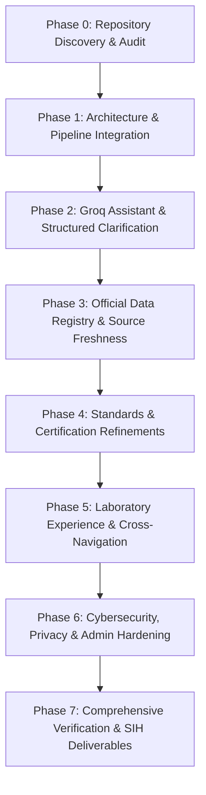

# e-BIS Sahayak — Phased Implementation & Engineering Plan

**Document Version:** 1.0.0  
**Target:** SIH 2026 Production Readiness & Excellence  

---

## 1. Implementation Principles & Guardrails

1. **Groq-Only LLM Inference**: Retain Groq as the sole inference provider with prompt engineering, bounding, and sensitive data scrubbing.
2. **Zero-RAG / Zero-Vector Overhead**: No vector databases, embeddings, or complex chunking pipelines. Utilize direct lightweight HTTP official-source lookups with in-memory TTL caching and strict domain whitelisting.
3. **Verified Official Data**: Never manufacture standards, fees, clauses, QCO statuses, or laboratory information.
4. **Multilingual Parity**: Preserve complete, natural tri-lingual support across English, Hindi, and Tamil.
5. **Security First**: Protect admin operations, sanitize user input, prevent prompt injection leaks, enforce rate limits, and ensure secret privacy.

---

## 2. Phased Roadmap & Milestones

---

## 3. Detailed Work Breakdown

### Phase 1: Architecture & Pipeline Integration
- **Objective:** Unify `query_service.py` with `intent_router.py` and `official_source_service.py`.
- **Tasks:**
  1. Integrate `IntentRouter` in `QueryService.process_query` to classify user intents (`ASSISTANT_CAPABILITY`, `CLARIFICATION_REQUIRED`, `STANDARD_INFORMATION`, `CERTIFICATION_INFORMATION`, `LABORATORY_INFORMATION`, `PRODUCT_APPLICABILITY`, etc.).
  2. For ambiguous queries (e.g. missing product name in certification inquiry), generate appropriate clarification questions and options with `response_type="CLARIFICATION_REQUIRED"`.
  3. For factual BIS queries, fetch trusted evidence from `OfficialSourceService` (whitelisted gov domains with TTL cache) and format citations with official URLs.
  4. Pass contextual evidence into the centralized Groq prompt so the model responds with grounded, verified facts.

### Phase 2: Groq Reliability, Bounding & Conversational Memory
- **Objective:** Ensure conversational continuity, graceful degradation on rate limits, and prompt injection defense.
- **Tasks:**
  1. Enforce bounded history windowing (last 6 turns) while resolving pronouns/follow-ups (e.g. "What are the fees for this?").
  2. Implement anti-adversarial detection in `intent_router.py` to gracefully deflect system prompt extraction attempts.
  3. Handle Groq HTTP 429 / 5xx with exponential backoff and localized fallback explanations.

### Phase 3: Official Data Registry & Freshness
- **Objective:** Provide a transparent, auditable dataset registry with explicit provenance and update procedures.
- **Tasks:**
  1. Maintain 576 verified laboratories across 27 States & UTs.
  2. Include official source metadata, last-verified timestamps, and official LIMS / BIS portal links.
  3. Support on-demand refresh via `/api/v1/laboratories/admin/refresh`.

### Phase 4: Standards Explorer & Certification Wizard UX
- **Objective:** Frictionless navigation from standards discovery to certification roadmaps and testing laboratories.
- **Tasks:**
  1. Ensure bidirectional links between Standard Details (`/standards/[code]`), Certification Roadmap (`/certification?standard=...`), and Testing Facilities (`/laboratories?standard=...`).
  2. Maintain accurate QCO mandatory indicators, gazette references, and clause breakdowns.

### Phase 5: Laboratory Directory Reliability
- **Objective:** High-performance search, multi-criteria filtering, and 100% availability.
- **Tasks:**
  1. Support live FastAPI querying + client-side embedded fallback in Next.js.
  2. Provide Quick Sector Chips (Electrical, IT, Water, Fans, Steel, Cement, Solar).
  3. One-click copy for official Lab Codes and direct links to BIS LIMS scopes.

### Phase 6: Cybersecurity, Privacy & Admin Hardening
- **Objective:** Zero vulnerabilities, protected admin endpoints, and safe error boundaries.
- **Tasks:**
  1. Enforce strict `X-Admin-Key` verification; deny access if key is missing or default.
  2. Enforce request body limit (2MB) and per-IP rate limiting (Token Bucket).
  3. Add Strict-Transport-Security (HSTS) and security headers.
  4. Redact sensitive tokens from logs and error messages.

### Phase 7: Verification & Final SIH Deliverables
- **Objective:** Execute full test suites, verify builds, and create final evaluation reports.
- **Tasks:**
  1. Run complete Pytest test suite across all 35 test files.
  2. Verify Next.js production build (`npm run build`).
  3. Generate final reports: `EXECUTIVE_SUMMARY.md`, `FINAL_AUDIT_REPORT.md`, `TEST_RESULTS.md`, `SECURITY_REVIEW.md`, `DATA_COVERAGE_REPORT.md`, `DEPLOYMENT_CHECKLIST.md`, `REMAINING_LIMITATIONS.md`.
