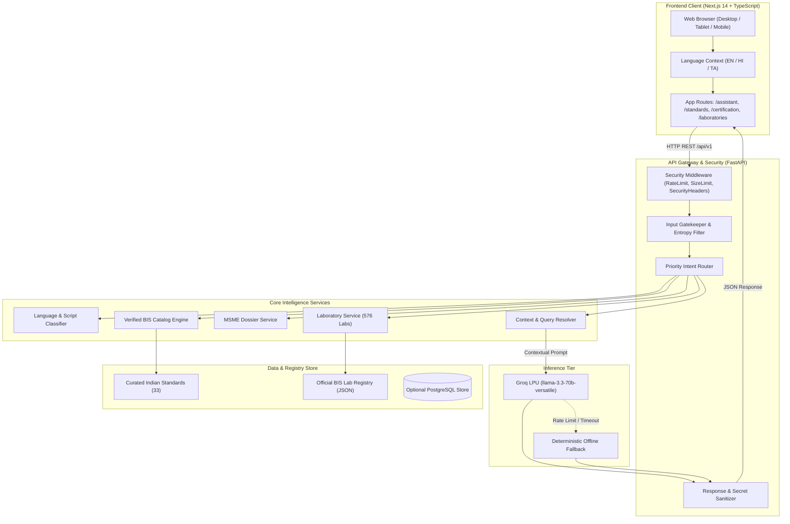
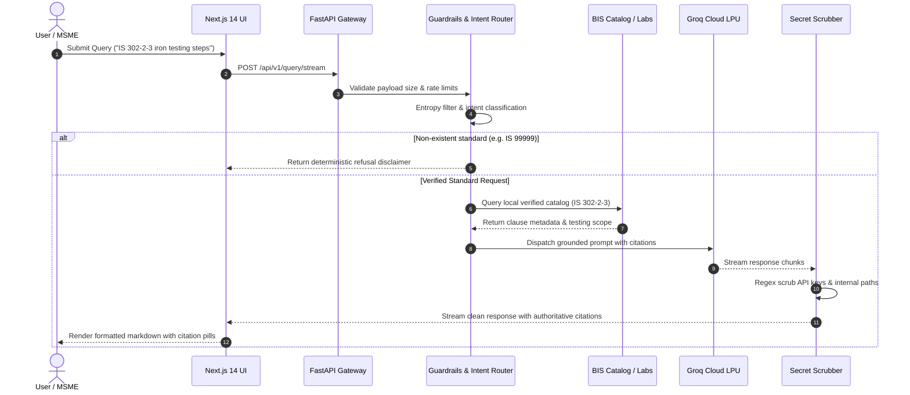

<div align="center">

# 🇮🇳 e-BIS Sahayak (ई-बीआईएस सहायक / இ-பிஐஎஸ் சஹாயக்)
### Intelligent Multilingual AI Assistant for Indian Standards & BIS Services
**Smart India Hackathon 2026 | Problem Statement: SIH2026-PS-107**

[](https://render.com)
[](https://www.python.org/)
[](https://fastapi.tiangolo.com/)
[](https://nextjs.org/)
[](https://www.typescriptlang.org/)
[](https://tailwindcss.com/)
[](https://groq.com/)
[](https://docs.pytest.org/)
[](LICENSE)

<br/>

[Key Features](#key-features) •
[Architecture](#system-architecture) •
[Quick Start](#quick-start) •
[API Reference](#api-reference) •
[Security & Guardrails](#security--hardening-controls) •
[Verification & Testing](#testing--verification) •
[Documentation](#documentation)

</div>

---

## 📌 Executive Overview

**e-BIS Sahayak** is an evidence-grounded, multilingual artificial intelligence assistant designed for the **Bureau of Indian Standards (BIS)** ecosystem under **Smart India Hackathon 2026 (Problem Statement: SIH2026-PS-107)**.

Navigating Indian technical regulations, Quality Control Orders (QCOs), standard specifications, laboratory networks, and certification roadmaps is historically complex for MSMEs, startups, manufacturers, and consumers. e-BIS Sahayak solves this through a **strictly grounded, evidence-first architecture**:

- **No Hallucinations / Fake Standards**: Queries referencing non-existent standards (e.g., `IS 99999`) or unsupported regulatory claims are deterministically rejected with authoritative abstentions.
- **Authoritative Provenance**: Every recommendation cites official Indian Standards (IS), gazette notifications, or verified laboratory registries.
- **Multilingual Equality**: Complete functional equality and 100% localization key parity across **English**, **Hindi (हिन्दी)**, and **Tamil (தமிழ்)**.
- **Single-Hop Groq LPU Inference**: Powered by Groq's high-speed LPU infrastructure running `llama-3.3-70b-versatile` with automated exponential backoff and localized fallback synthesis.

---

## 🎯 Project Objectives (SIH2026-PS-107)

1. **Democratize Standards Awareness**: Provide immediate, accessible technical standard guidance to rural and regional businesses in their native languages.
2. **Streamline BIS Certification**: Empower MSMEs and domestic manufacturers to navigate Scheme-I (ISI Mark), Scheme-II (CRS), FMCS, Hallmarking, and ECO Mark with interactive roadmap wizards.
3. **Automate Compliance Documentation**: Instantly generate and export comprehensive, print-ready **MSME Compliance Dossiers** (A4 PDF/HTML) detailing stage-by-stage documentation, testing protocols, and fee structures.
4. **Transparent Lab Discovery**: Enable geospatial and state-filtered search across **576 verified BIS laboratories** (430 recognized, 140 empanelled, 6 institutional apex).
5. **Absolute Security & Provenance**: Guarantee client-side safety with regex secret scrubbing, rate limiting, and strict input validation.

---

## ✨ Key Features

| Capability | Description |
| :--- | :--- |
| 🤖 **Grounded AI Assistant** | Context-aware technical conversational assistant with multi-turn memory, real-time citation links, and explicit confidence badges (`authoritative_curated`, `high`, `verified`). |
| 📜 **Standards Clause Explorer** | Search and deep-dive into verified Indian Standards (33 curated standards across Electronics, Civil, Automotive, Food, Safety, Textiles) with clause breakdowns. |
| 🗺️ **Certification Wizard** | Interactive 5-step roadmap generator for BIS schemes with regulatory requirements, estimated timelines, and mandatory fee structures. |
| 📄 **MSME Compliance Dossier** | One-click generation and export of formal compliance dossiers with print styling, ready for audit submission and executive review. |
| 🔬 **Laboratory Directory** | Searchable database of 576 accredited test facilities across 27 States/UTs filterable by State, City, and testing scope. |
| 🌐 **Trilingual Interface** | Native language switching between English, Hindi, and Tamil with 100% dictionary key parity (420 keys per locale). |
| 🛡️ **Anti-Hallucination Gatekeeper** | Pre-routing entropy checks, regex-based standard verification, and deterministic abstention responses. |
| ⚡ **Sub-3ms Local Caching** | Cached catalog queries and fast-path guardrail responses resolve in under 3 ms. |

---

## 🏗️ System Architecture

e-BIS Sahayak is built on a clean, decoupled architecture: a **FastAPI backend gateway** providing RESTful APIs and guardrails, paired with a modern **Next.js 14 App Router frontend**.



### Request Lifecycle Sequence



---

## 🗂️ Project Directory Structure

```text
SIH2026-PS-107/
├── .github/                     # GitHub workflows and issue/PR templates
│   ├── workflows/ci.yml         # Automated CI (pytest + Next.js build)
│   ├── ISSUE_TEMPLATE/          # Bug report and feature request templates
│   └── PULL_REQUEST_TEMPLATE.md # Standard PR checklist
├── backend/                     # FastAPI Python 3.11+ application
│   ├── app/
│   │   ├── api/v1/endpoints/   # Route handlers (query, standards, cert, labs)
│   │   ├── core/                # Configuration, logging, security middlewares
│   │   ├── db/                  # Verified catalog seeds & models
│   │   ├── evaluation/          # Benchmark & RAG evaluation suites
│   │   ├── schemas/             # Pydantic v2 validation contracts
│   │   ├── services/            # Business logic (Groq client, intent router, dossier)
│   │   ├── main.py              # Application entrypoint & CORS setup
│   │   └── preflight.py         # System diagnostics & registry verifier
│   ├── data/                    # Authoritative lab directory JSON (576 labs)
│   ├── tests/                   # 291 comprehensive pytest test suites
│   ├── Dockerfile               # Production multi-stage Docker build
│   └── requirements.txt         # Minimal pinned backend dependencies
├── frontend/                    # Next.js 14 App Router application
│   ├── src/
│   │   ├── app/                 # Routes: /assistant, /standards, /certification, /laboratories
│   │   ├── components/          # Reusable UI widgets & navigation
│   │   ├── context/             # Multilingual LanguageContext
│   │   └── locales/             # 100% Key-Parity Dictionaries (en, hi, ta)
│   ├── public/                  # Static assets and icons
│   ├── Dockerfile               # Production multi-stage Node 20 build
│   └── package.json             # Frontend dependencies & scripts
├── docs/                        # Complete technical documentation suite
│   ├── architecture.md          # Architectural blueprints and patterns
│   ├── deployment-checklist.md  # Production hardening guidelines
│   ├── feature-completeness-matrix.md
│   ├── limitations-roadmap.md   # Measured boundaries & future milestones
│   ├── risk-register.md         # Threat matrix & mitigation strategies
│   └── security-review.md       # Full security audit report
├── docker/                      # Database initialization scripts
├── docker-compose.yml           # Complete containerized stack configuration
├── start.bat                    # One-click Windows startup launcher
├── stop.bat                     # Clean port and process shutdown utility
├── run_tests.bat                # Automated test runner script
├── CONTRIBUTING.md              # Open-source contribution guidelines
├── SECURITY.md                  # Vulnerability disclosure policy
├── CODE_OF_CONDUCT.md           # Contributor code of conduct
├── CHANGELOG.md                 # Project release notes & history
└── README.md                    # Project presentation and documentation
```

---

## 🚀 Quick Start

### Prerequisites
- **Python**: Version `3.10` or higher (3.11 recommended)
- **Node.js**: Version `18.0.0` or higher (Node 20 recommended)
- **npm**: Version `9.0.0` or higher
- **Groq API Key**: Free tier or production key from [console.groq.com](https://console.groq.com)

---

### Option A: One-Click Windows Launcher (Recommended)

1. Clone the repository:
   ```bash
   git clone https://github.com/0MRX0-00/SIH2026-PS-107.git
   cd SIH2026-PS-107
   ```
2. Configure your environment:
   ```bash
   copy .env.example .env
   # Open .env and add your GROQ_API_KEY=gsk_...
   ```
3. Run the automated starter script:
   ```cmd
   start.bat
   ```
   *The launcher will check ports, run pre-flight diagnostics, start FastAPI on port `8000`, and start Next.js on port `3000`.*
4. Open [http://localhost:3000](http://localhost:3000) in your browser.
5. To gracefully stop all services:
   ```cmd
   stop.bat
   ```

---

### Option B: Manual Installation

#### 1. Backend Setup
```bash
cd backend

# Create virtual environment
python -m venv venv

# Activate virtual environment
# Windows:
.\venv\Scripts\activate
# Linux / macOS:
source venv/bin/activate

# Install dependencies
pip install -r requirements.txt

# Configure environment
cp ../.env.example .env
# Ensure GROQ_API_KEY is configured in .env

# Run Pre-flight Diagnostics
python -m app.preflight

# Start FastAPI server
uvicorn app.main:app --host 0.0.0.0 --port 8000 --reload
```
*Backend Swagger API documentation is available at [http://127.0.0.1:8000/docs](http://127.0.0.1:8000/docs).*

#### 2. Frontend Setup
```bash
cd frontend

# Install dependencies
npm install

# Start Next.js development server
npm run dev
```
*Frontend portal will be live at [http://localhost:3000](http://localhost:3000).*

---

### Option C: Docker Compose

Run the entire stack (PostgreSQL + FastAPI Backend + Next.js Frontend) in isolated containers:

```bash
# Provide environment variables
cp .env.example .env
# Edit .env and supply your POSTGRES_PASSWORD and GROQ_API_KEY

# Build and launch all containers
docker compose up --build -d

# Check service logs
docker compose logs -f
```

---

## ⚙️ Environment Configuration

Configuration is managed via environment variables. Copy `.env.example` to `.env` in the root and configure:

| Variable | Default Value | Description |
| :--- | :--- | :--- |
| `GROQ_API_KEY` | `""` *(Required)* | Groq Cloud LPU API key for inference. |
| `GROQ_MODEL` | `llama-3.3-70b-versatile` | LLM model checkpoint for Groq inference. |
| `ENVIRONMENT` | `development` | Deployment environment (`development` or `production`). |
| `PORT` | `8000` | Port for the FastAPI backend service. |
| `BACKEND_CORS_ORIGINS` | `["http://localhost:3000"]` | Allowed CORS origins as a JSON string array. |
| `RATE_LIMIT_PER_MINUTE` | `40` | Sliding window rate limit per client IP. |
| `ADMIN_API_KEY` | `""` | Key for privileged administrative endpoints. |
| `NEXT_PUBLIC_API_URL` | `http://localhost:8000` | URL of the backend API consumed by Next.js. |
| `NEXT_PUBLIC_APP_NAME` | `e-BIS Sahayak` | Application display name. |

---

## 🔌 API Reference

The backend provides well-documented, versioned REST endpoints under `/api/v1/`:

| Method | Endpoint | Description |
| :--- | :--- | :--- |
| `GET` | `/health` | Healthcheck and readiness probe with uptime and database status. |
| `POST` | `/api/v1/query` | Synchronous technical standards query with citation provenance. |
| `POST` | `/api/v1/query/stream` | Server-Sent Events (SSE) streaming response for AI assistant dialogue. |
| `GET` | `/api/v1/standards` | List curated Indian Standards with category filtering. |
| `GET` | `/api/v1/standards/{id}` | Retrieve comprehensive standard details and clause breakdowns. |
| `GET` | `/api/v1/certification/schemes`| Retrieve all 10 BIS conformity assessment schemes. |
| `POST` | `/api/v1/certification/calculate` | Compute customized certification fees and processing timeline. |
| `POST` | `/api/v1/certification/export-dossier` | Generate formatted HTML/JSON compliance dossier for MSMEs. |
| `POST` | `/api/v1/certification/download-dossier` | Stream download ready-to-print A4 compliance dossier. |
| `GET` | `/api/v1/laboratories` | Filter and query across 576 accredited BIS test laboratories. |
| `GET` | `/api/v1/laboratories/stats` | Aggregate laboratory statistics by accreditation type and state. |

Interactive OpenAPI documentation is hosted locally at `http://127.0.0.1:8000/docs` and Redoc at `http://127.0.0.1:8000/redoc`.

---

## 🧪 Testing & Verification

e-BIS Sahayak enforces rigorous automated testing across both backend and frontend layers.

### Run Backend Test Suite (292 Tests)

```bash
cd backend
python -m pytest tests/ -v
```

```text
======================= 292 passed, 1 warning in 14.84s =======================
```

The test suite covers:
- **Functional Integrity**: Query processing, language scripts, and data providers.
- **Evidence Grounding**: Refusal of unindexed fake standards (`IS 99999`), citation accuracy.
- **Dossier Generation**: MSME compliance export, schema validation, and PDF print formatting.
- **Security Middlewares**: Secret scrubbing regex, 2MB body size limit, sliding rate limiter.
- **Multilingual Parity**: Exact structural key parity (420 keys in EN, HI, TA).

### Run Frontend Verification

```bash
cd frontend

# Run ESLint validation
npm run lint

# Run Production Next.js Build
npm run build
```

```text
✓ Compiled successfully
✓ Linting and checking validity of types
✓ Generating static pages (11/11)
✓ Finalizing page optimization
```

---

## 🛡️ Security & Hardening Controls

- **Secret Scrubbing Filter**: All LLM streaming chunks pass through regex masks (`_scrub_sensitive_data()`) preventing accidental leakage of API keys, bearer tokens, or server paths.
- **Strict Rate Limiting**: In-memory sliding-window limiter enforces 40 req/min per IP with LRU eviction capped at 10,000 entries.
- **Payload Streaming Limiter**: `SizeLimitMiddleware` truncates oversized HTTP request bodies at 2MB to prevent buffer denial-of-service.
- **Traceback Sanitization**: Global exception handlers trap unhandled errors and return sanitized generic messages without exposing Python tracebacks.
- **Fail-Closed Pre-flight Check**: Validates that all data sources, seed catalogues, and configurations are intact before accepting traffic.
- **Defensive Prompt Delimiters**: User inputs are wrapped in rigid boundary markers to counter adversarial prompt injection.

---

## 📚 Documentation

Detailed technical documentation is available in the [`docs/`](docs/) directory:

- [System Architecture](docs/architecture.md)
- [Deployment Checklist](docs/deployment-checklist.md)
- [Feature Completeness Matrix](docs/feature-completeness-matrix.md)
- [Limitations & Engineering Roadmap](docs/limitations-roadmap.md)
- [Risk Register & Threat Assessment](docs/risk-register.md)
- [Security Review](docs/security-review.md)

---

## 🤝 Contributing

Contributions to e-BIS Sahayak are welcome! Please read our [Contributing Guidelines](CONTRIBUTING.md) and adhere to our [Code of Conduct](CODE_OF_CONDUCT.md).

1. Fork the Project
2. Create your Feature Branch (`git checkout -b feature/AmazingFeature`)
3. Commit your Changes (`git commit -m 'feat: add AmazingFeature'`)
4. Push to the Branch (`git push origin feature/AmazingFeature`)
5. Open a Pull Request

---

## ⚖️ License & Disclaimer

### License
Distributed under the **MIT License**. See [`LICENSE`](LICENSE) for more information.

### Official BIS Disclaimer
*e-BIS Sahayak is an educational and technical research prototype created for Smart India Hackathon 2026 (SIH2026-PS-107). It is **not** an official platform of the Bureau of Indian Standards (BIS) or the Government of India. For binding regulatory certifications, formal applications, and statutory compliance, always consult the official BIS portal at [bis.gov.in](https://www.bis.gov.in) and [manakonline.in](https://www.manakonline.in).*

---

<div align="center">
  <b>Developed for Smart India Hackathon 2026</b><br/>
  <i>Empowering Indian Industry Through Standards & Quality Assurance</i>
</div>
